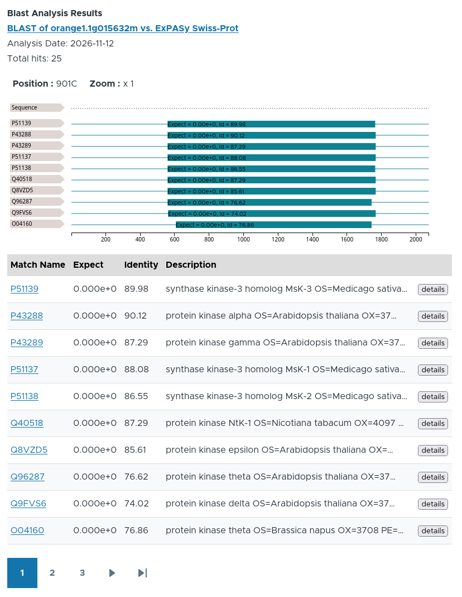

# Overview
The Tripal Analysis BLAST module extends Tripal for display of BLAST local alignments on gene,
mRNA or protein pages on a [Tripal](http://tripal.info) site.
This module is designed for Tripal v4. It provides:

1. An importer for loading BLAST XML results created using the NCBI blast program.
   Data is loaded into Chado and BLAST results are automatically associated with
   genes, mRNA (transcripts), or proteins.
2. Blast results appear on each feature page via an interactive viewer and a
   tabular list (see screenshot for example).

# Related Modules
In addition to display of BLAST results there are a few other modules that support BLAST.
These include:
1. [Tripal Sequence Similarity Search](https://github.com/tripal/tripal_sequence_similarity_search).
   This module provides a web front-end for site visitors to execute BLAST within the Tripal site.
   It supports fast BLAST using Diamond and supports execution of BLAST jobs on a remote server
   (not the web server).
2. [Tripal BLAST](https://github.com/tripal/tripal_blast).  This module provides a web front-end for
   site visitors to execute BLAST within the Tripal site.

How is this module different?  This module does not provide an interface for end-users
to execute BLAST jobs. Rather it is meant to import BLAST results to appear on gene,
transcript or protein pages to provide functional annotations.

# Documentation

Installation and usage instructions for each version of this module.

1. [Documentation for Tripal v4](https://tripal.github.io/tripal_analysis_blast).
2. [Documentation for Tripal v3](https://tripal.readthedocs.io/en/latest/user_guide/example_genomics/func_annots.html).
3. [Documentation for Tripal v2](http://tripal.info/node/106)

# Screenshot

