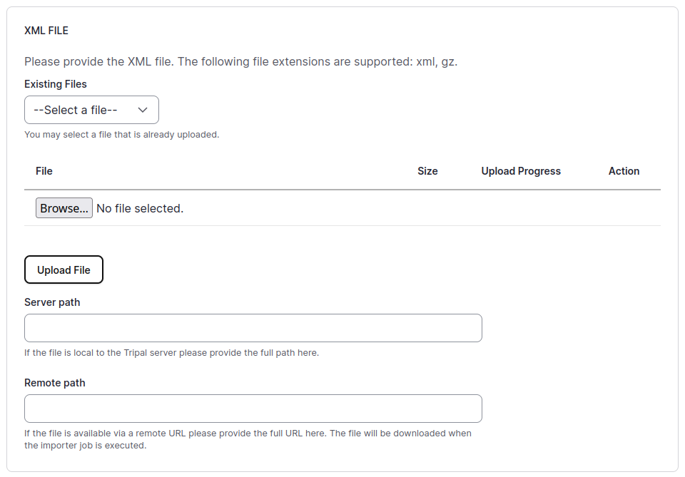

# Importing BLAST analyses

!!! warning "Under Development"

    This documentation is still being developed as this module is being upgraded.

Performing the BLAST search
---------------------------

One way to produce the BLAST xml file is to run the appropriate NCBI BLAST
program on your own computer. If you don't already have BLAST+ installed,
[See the NCBI documentation](https://www.ncbi.nlm.nih.gov/books/NBK569861/) for installation instructions.

There are two steps: creating the BLAST database, and performing the BLAST search.

You can download existing compiled BLAST databases, ,
or if you want to create your own database locally from your own FASTA file, 
[NCBI has documentation here describing how to do this](https://www.ncbi.nlm.nih.gov/books/NBK569841/).

The command to run the BLAST search will use one of the
[blast commands as described here](https://www.ncbi.nlm.nih.gov/books/NBK569839/)).

See the [NCBI quick start page](https://www.ncbi.nlm.nih.gov/books/NBK569856/)
for an overview of how to run these commands.

!!! important Generate output in xml format
    This module requires that the blast output be in xml format.
    To do so, you will need to include this parameter when running your blast search: `-outfmt 5`.

!!! hint Compressed input files not supported
    The BLAST programs do not support using compressed files as input.
    Make sure your FASTA files have not been compressed with gzip or other programs.
    If they were compressed, you will have to temporarily uncompress them first.
    However, you can compress the xml output file with gzip if desired.

Adding a BLAST Database to your site
------------------------------------

A BLAST analysis involves running the NCBI blast program using a set of sequences,
and looking for matches in some database. A database is simply a collection of
multiple sequences. The collection can be relatively small, or it can be enormous
such as the NCBI nr and ExPASy SwissProt databases.

The first step is to create a record in chado referencing the BLAST database that you
used for performing the BLAST search, even if it is a database that you created locally.

In Tripal, creating a database is done by a site administrator by navigating to 
**Tripal → Tripal Terms → Manage External Databases**
and then clicking on **Add a new database**.

As an example, suppose we have a genome assembly with gene prediction protein sequences,
and we performed a `blastp` analysis of those predictions using the ExPASy SwissProt database.

We could then use the following values for adding the SwissProt database:

  | Field Name | Value |
  |------------|-------|
  | External Database Name | ExPASy Swiss-Prot |
  | Database Description | A curated protein sequence database which strives to provide a high level of annotation, a minimal level of redundancy and high level of integration with other databases |
  | Database URL | https://expasy.org/sprot/ |
  | Database URL prefix | https://www.uniprot.org/uniprot/ |

Adding a Database cross-reference record
----------------------------------------

Organizations such as NCBI or ExPASy contain many different blast databases,
and different versions of those databases which are updated periodically.
We want to create a specific cross-reference to the exact database and version
that we used for our BLAST search.
Navigate to
**Tripal → Tripal Terms → Manage Database Cross References**
and then clicking on **Add a new database cross reference**.

  | Field Name | Value | Notes |
  |------------|-------|-------|
  | External Database Name | ExPASy Swiss-Prot | This matches the database record that we just created |
  | External Database Accession | Release 2026_03 | This specifies which version of the database was used |
  | External Database Accession Version |  | can be left blank |
  | External Database Accession Description |  | can be left blank |

Adding an Analysis record for the BLAST search
----------------------------------------------

We need a way to describe to a site user how the BLAST analysis was performed,
what query sequence set was used, and what database was it compared to.
We do so using the "Analysis" content type.
Navigate to **Tripal → Content → + Add Tripal Content**
then select **Analysis**. An example:

  | Field Name | Value | Notes |
  |------------|-------|-------|
  | Name | Blast analysis of the Tripalus genome assembly to Swiss-Prot 2026_03 |  |
  | Description | UniProtKB Release 2026_03 consists of 150,006,383 entries |  |
  | Software Name | blastp |  |
  | Software Version | 2.17.0+ |  |
  | Data Source Name | | optional |
  | Data Source Version | | optional |
  | Data Source URI | optional, the next item will provide the link to Swiss-Prot |
  | Database Reference Annotations | ExPASy Swiss-Prot:Release 2026_03 | First select database, then select the accession |
  | Relationship | Tripalus gene prediction analysis | An example. You should link to a separate analysis describing your genome assembly or gene prediction |

Import the BLAST XML results
----------------------------
First navigate to the importer form **Tripal → Data Loaders → Chado BLAST XML results loader** and the importer page will be presented.
The first part is where you upload your xml file.
There are multiple methods for providing the results file: via an upload interface,
specifying a remote URL, or a file path that is local to the server.
Most likely, you will upload or provide a remote URL.

 1. Upload your XML file here.

 2. Select the analysis you created.

 3. Select the database you created.

